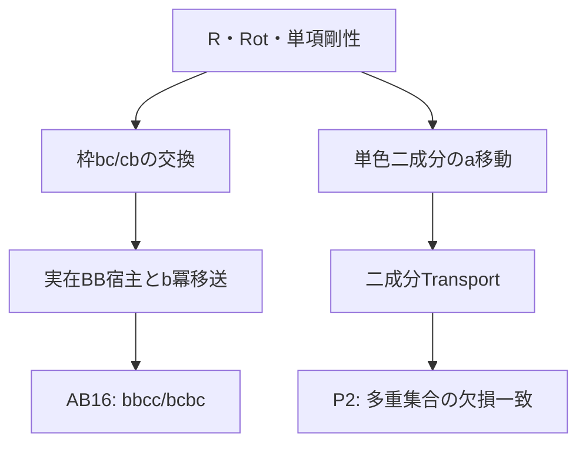

# Astra 第十六段・独立数学探索 完成報告
## 非巡回核 bbcc/bcbc の欠損剛性と、二成分のまま行う Parikh 加法性

2026年11月16日（日本時間）

## 今回確立／反証／未解決

**今回確立したこと［PROVED：以下の一般手証明］**

1. **AB16**：`bbcc/bcbc` に単独Rot証人と実在する加法的連結宿主があるとき、
   \[
   N\ge6\max(\delta_1,\delta_2)+1\quad\Longrightarrow\quad\delta_1=\delta_2.
   \]
   非巡回対の最初の指定問題を、明示した絶対定数 `C=6,C′=1` で解決する。最適定数とは主張しない。TR/BTや原文CAには依存しない。
2. **AB16-block**：非消去逆像により `uuvv/uvuv`（任意の非空語ブロック）へ拡張できる。内部aを含む場合の室は `N≥6max(h₁,h₂)+1` であり、δとhを混同しない。
3. **P2（単色二成分版P_tree）**：短い導出組がすべて `(b^p,c^q)` 型である明示的な部分クラスでは、交錯・入れ子の木由来種から、**二核を連結せずに**多重集合の非a Parikh一致が欠損和一致を強制する。さらに**P2+**では各成分へのa混入も、明示した余剰a条件の下で扱う。種B,Cに小欠損窓を課す必要はない。正確な追加条件は§5。

**今回反証したこと**：一般命題の新しい反例は提出しない。AB16の仮定に反する欠損割当て、およびP2部分クラスの非線形な欠損割当てについて、短いa冪に至る具体的矛盾証明書を構成した。これは対象命題の反証ではなく、そのような割当ての実現不能性である。

**未解決［OPEN］**：任意の非巡回核に対する一般AB、一般の隣接交換 `pbcq/pcbq`、任意の成分内容・内部aを許すP_tree、小欠損窓IH、非可換予想U、正式 `op:fanout-two`。今回の成果を一般characteristic-data長の上界やLG必要性の決着と呼ばない。

ここでPROVEDは本文の全称的な手証明に対する自己判定であり、専門家査読・別エージェントの独立数学監査・形式証明器による認証を意味しない。有限計算の結果は別ラベルで記す。

## 1. 一次資料を実際に確認した範囲

添付依頼書を全文読んだ。GitHubの取得時の `main` は

`d1718eff64830be0ae6e2483fbeda8a6fe04843d`

であった。以後の取得はこのcommitに固定した。基底URLは
[固定した研究ディレクトリ](https://github.com/growupkuriyama-hub/Papers/tree/d1718eff64830be0ae6e2483fbeda8a6fe04843d/02-v2-lg-fanout-boundary)。

| 実際に取得した資料 | 実際に参照した箇所・扱い |
|---|---|
| `HANDOFF_CURRENT.md` | 第十五段を反映した最新状態、現行論文の射程 |
| `main.tex` | `def:grammar-properties`, `def:tuple-substitutable`, `lem:thickness-equivalence`, `op:fanout-two`。論文全文の新規再査読を行ったとは主張しない |
| `reviews/STATUS_ASTRA_FANOUT2_ROUND15_2026-11-16.md` | BT/NF/IH/P_treeの最新判定 |
| `reviews/astra_fanout2_round15_report_2026-11-16.md` | §§3–6のR/U/Rot、非消去逆像、BT、NF、ST、明示文法、厚さ、最小木、交錯・入れ子の証人；再現コードとログ |
| `reviews/audit_astra_fanout2_round15_independent_2026-11-16.md` | §§B–DのBT移送、IH反例の独立証明、量化上の注意 |
| `reviews/audit_claude_round14_noncomm_Parikh_independent_2026-11-16.md` | TR、67語CA反例、CA*、Fの非空条件 |
| `reviews/audit_claude_round13_noncomm_U_independent_2026-11-15.md` | R/U/L2/Rot、40語X1反例、T1の射程 |
| `reviews/Fable_C_complete_independent_mathematical_audit_2026-11-15.md` | 可換性を必要とする交換・整数関係、木の分岐類と窓の量化 |
| `reviews/claude_round14_noncomm_Parikh_report_2026-11-15.md` | §§2–3のFとP_tree定式化、§§5–6の交錯障害とT2′ |
| 同 `...next_obligations...md`、`ROUND14_COMPLETE_SOURCE_AUDIT_2026-11-16.md` | 残存義務、および関連する原証明・コードの所在。完全ソース束全体を逐行監査したとは主張しない |
| `reviews/round15/` の6実ファイルと `SHA256SUMS.txt` | コード、原stdout、証明書、取得索引、README、ハッシュを確認 |

17取得ファイルすべてについてGit blob SHAを実バイトから再計算して一致を確認した。第十五段のSHA-256一覧の6項目も一致した。`round15_check.py`を実行し、終了コード0、stdoutは保存済みログと**バイト単位で一致**した。取得先、blob SHA、SHA-256、バイト数は再現ZIPの `source_manifest.json` にある。

資料の正本は変更していない。GitHubへの書込み、PR、commit、論文本文・日本語版・PDF・PAPER.yamlの編集は一切行っていない。ZIP内の `sources/` は読取り用スナップショットである。

## 2. 規約と適用可能性の先行監査

`Σ={a,b,c}`、内容型 `c(w)=alph(w)`、`L`は1穴・2穴について内容型付き組代入可能とする。MCFL性は各局所証明に不要だが、木への適用では依頼どおり `L∈C^{mcf}_{2,c}` とする。

`a^N∈L` は最短の正a冪。文脈 `(l,m,r)` の中央mは非空、比較タプルの全成分も非空とする。組代入可能性を用いる形は常に

\[
E_0[x],E_0[y],E_1[x]\in L\quad\Longrightarrow\quad E_1[y]\in L
\tag{Rect}
\]

であり、成分ごとの**実際の**内容型を照合する。

Rot核κの外側a量をλ、`h=N−λ`、`δ=h−|κ|_a` とする。AB16ではκがaを含まないためh=δ。P2の木由来核 `b^p a c^q` では内部aが1個あり、`h=δ+1` である。

| 操作 | 比較断片・型 | 共通宿主／室 | 陰性対照に対する確認 |
|---|---|---|---|
| R | 正のa冪二成分、`({a},{a})` | `a^N`、二冪和≤N−1 | 40語・67語でも成り立つ |
| Rot | `aκ,κa`、同じ実内容 | 外側aの両端正、λ≥3 | aのない片をa付き片と比較しない |
| AB16のF | `(bc,a^i),(cb,a^{i+s})`、`({b,c},{a})` | 二つの単独核を同じ枠 `b _ c` に置く | u,u′とも非空；共有・試験中央とも非空 |
| b冪移送 | `(b,bb),(bb,b)`、`({b},{b})` | 実際に導いた `bbbbcccc a^E` | Parikh一致だけから交換しない |
| P2の成分交換 | `(b^p,c^q a^i),(b^{p′},c^{q′}a^{i′})`、`({b},{a,c})` | §5.3の二つの単独受理語 | 非a型だけでなくaの有無まで一致 |
| 加法的種 | AB16は仮定された語、P2は木の同時置換語 | それぞれ欠損和のbudgetを実測 | 67語の非加法的種から推定しない |

40語X1反例・67語CA反例を、新しい独立の全1穴・2穴分布検査でも再検証した。第十五段IH反例はP2の肯定的な検査対象にも使用した。原文X1、原文CA、一般IH、TR/BTを今回の二つの主証明の補題として使っていない。

## 3. 基礎操作の明示的証明

### 3.1 正のa連再配分 R

`i,j,k,l≥1`, `i+j=k+l≤N−1` とする。

\[
x=(a^i,a^j),\quad y=(a^k,a^l),\quad
E_0=(\varepsilon,a,a^{N-1-i-j}).
\]

`E₀[x]=E₀[y]=a^N`。試験文脈 `E₁=(P,Q,R)` はQ≠εである限り任意でよく、`P a^i Q a^j R` から `P a^k Q a^l R` が従う。これは0長のa連を作る操作ではない。

### 3.2 Rotと外側aの移動

`a^p κ a^q∈L`, p,q≥1, `3≤λ=p+q≤N−1` とする。Rから `a²κa^{λ−2}` と `aκa^{λ−1}` を得る。

\[
x=aκ,\quad y=κa,\quad E_0=(a,a^{λ-2}).
\]

実型は双方 `alph(κ)∪{a}`。任意の1穴試験文脈へのRectで `aκ≡κa`。この合同を繰り返せば外側aを左右の一方へ全て移せる。既存の内側のaを勝手に消す主張ではない。

### 3.3 オフセット付き単項剛性 U_shift

同じPについて `P a^e,P a^f∈L`, e,f≥1, `0<g=|e−f|<N` は不可能である。`lo=min(e,f)` として

\[
x=a^{g+1},\ y=a,\ E_0=(P,a^{lo-1}),\ E_1=(a^{N-g-1},\varepsilon).
\]

E₀の二語は仮定の語、E₁[x]=a^N、したがってE₁[y]=a^{N−g}。正長かつN未満で矛盾する。

**eまたはfがN以上でもよい。** 大きい末尾a連から共通の末尾を文脈側に移して比較している。AB16では実際にその場合が起こるため、総a数<Nを必要とするL2で代用しない。

## 4. 主課題A：非巡回AB16

### 4.1 定理の全称的主張［PROVED］

`B=bbcc`, `C=bcbc` がRot核であり、外側量 `λ₁=N−d₁`, `λ₂=N−d₂`、d₁,d₂≥1とする。実際に

\[
a^xB a^yC a^z\in L,\qquad x,y,z\ge0,\qquad x+y+z=N-d_1-d_2
\tag{A-host}
\]

があるとする。`M=max(d₁,d₂)` と置く。**`N≥6M+1` ならd₁=d₂。** 定数6と1はN、文法サイズ、厚さに依存しない。

### 4.2 枠内転置の重み

`s=d₁−d₂=λ₂−λ₁` とする。`i,i+s≥1` かつi≤λ₁なら

\[
x=(bc,a^i),\quad y=(cb,a^{i+s}),\quad
E_0=(a^{λ_1-i}b,c,\varepsilon)
\tag{F+}
\]

は適法であり、

\[
E_0[x]=a^{λ_1-i}B a^i,\qquad
E_0[y]=a^{λ_1-i}C a^{i+s}
\]

はRotから受理される。任意の非空Qとe≥iに対し、試験文脈

\[
E_1=(P,Q,a^{e-i})
\]

は `PbcQ a^e` を `PcbQ a^{e+s}` に移す。逆向きはB/Cを交換し、sを−sにする。必要なら `i=1+max(0,−s)` を選ぶ。型は `({b,c},{a})`、共有中央はc、試験中央はQである。

以下ではQは常に非空のb/c語である。大きい末尾指数eに対してiを大きくする必要はなく、残りは試験文脈の末尾に置く。

### 4.3 加法的宿主からBBを得る

Rot合同で(A-host)の外側aを右へ集め、`BC a^t∈L`, `t=N−d₁−d₂` を得る。

`i=1+max(0,s)`, `j=i−s` として、

\[
x=C a^i,\quad y=B a^j,\quad
E_0=(\varepsilon,a^{λ_2-i}),\quad E_1=(B,a^{t-i}).
\]

両片は型 `{a,b,c}`、E₀の二語は単独Rot語、E₁[x]は今のBC宿主である。したがって

\[
BB a^{N-2d_1}=bbccbbcc\,a^{N-2d_1}\in L.
\tag{BB}
\]

ここだけが種の加法的budgetを使う箇所であり、任意の非加法的種を同じ指数に変更してはいない。

### 4.4 具体的な交換列

`D=N−2d₁`, `E=D−4s=N−6d₁+4d₂`, `T=E+3s=N−3d₁+d₂` と置く。

| 順序 | b/c部分 | 末尾a指数 | 使用操作 |
|---|---|---:|---|
| 0 | `bbccbbcc` | D | (BB) |
| 1 | `bbcbcbcc` | D−s | `cb→bc` |
| 2 | `bbbccbcc` | D−2s | `cb→bc` |
| 3 | `bbbcbccc` | D−3s | `cb→bc` |
| 4 | `bbbbcccc` | E=D−4s | `cb→bc` |
| 5 | `bbbcbccc` | E+s | `bc→cb` |
| 6 | `bbcbbccc` | E+2s | `bc→cb` |
| 7 | `bcbbbccc` | T=E+3s | `bc→cb` |

各手は§4.2のF+/F−を該当する隣接二文字に適用する。右側のQは表から直接読め、いずれも少なくとも1文字ある。完全なx,y,E₀,E₁を展開した数値証明書も同梱した。

次に、手4の**同じ語を二通りに切る**：

\[
x=(b,bb),\quad y=(bb,b),\quad E_0=(\varepsilon,b,cccc\,a^E).
\]

`E₀[x]=E₀[y]=bbbbcccc a^E`。型は `({b},{b})` である。試験文脈

\[
E_1=(\varepsilon,c,bccc\,a^T)
\]

についてE₁[x]は手7、よって

\[
bbcbbccc\,a^T\in L.
\tag{PT}
\]

一方、手6は `bbcbbccc a^{T−s}∈L` を与えている（手7への逆Fでも再取得できる）。s≠0ならU_shiftで矛盾する。

**最小の数値例**：N=13,d₁=2,d₂=1ではD=9,E=5,T=8。手4は `bbbbcccc a^5`、最後の同接頭語対は `bbcbbccc a^8` と `bbcbbccc a^7`。U_shiftでa¹²を得てa¹³の最短性に反する。これは定数の最適性や最小反例サイズを意味しない。

### 4.5 全指数・型・空区切りの監査

1. `λ_i=N−d_i≥5M+1≥6` かつλ_i≤N−1。単独RotのRは合法。
2. `t≥4M+1`、`D≥4M+1`。§4.3のi,jおよび文脈末尾は適法。
3. s≥0なら表の最小指数はEで、`E=N−6d₁+4d₂≥5`。s<0なら最小指数はDで、`D≥5`。各Fの交換前後の指数は正である。
4. 各Fで最小の `i=1+max(0,−s)`（逆向きも同様）を使える。i≤λ₁、対応するi′≤λ₂は上記の室から従う。
5. b冪移送の両中央はbとcで非空。b/ bbも非空。
6. `|s|≤M−1<N`。末尾の大きさ自体はNを超えてよいが、U_shiftの差の条件は満たす。

よってd₁=d₂。証明はNや文法サイズに依存しない有限種類の文脈操作からなる。∎

### 4.6 ブロックへの拡張［PROVED］

`u,v∈Σ⁺` とし、β=uuvv、γ=uvuvをRot核とする。単独証人の外側量をλ₁,λ₂、h_i=N−λ_i≥1とする。実在する宿主 `a^xβa^yγa^z∈L` の外側量が `N−h₁−h₂` であり、`N≥6max(h₁,h₂)+1` とする。このときh₁=h₂、したがってδ₁=δ₂。

証明：形式文字A,B,Cから `μ(A)=a,μ(B)=u,μ(C)=v` とする。K=μ⁻¹(L)では、内容が成分ごとに同じなら像の実内容も同じである。非消去なので穴と中央を空にしない。KのRectの四語をμでLへ写すことでKの組代入可能性が従う。KではBBCC/BCBCの外側欠損がh₁,h₂なのでAB16を適用する。μ(Aⁿ)=aⁿのため最短正A冪はN。像の内部a数は両核とも `2|u|_a+2|v|_a` で等しい。MCFL逆像閉性や新しい文法の厚さは使わない。∎

正の欠損を持つ核をNFで正規化した結果がuuvv/uvuvになる場合も、正規化後のhと加法的budgetを確認すれば適用できる。NFは既存の限定補題であり、内部aの存在位置を任意に変える一般化は主張しない。

### 4.7 なぜ一般ABまで解けたことにならないか

`bbcc/bcbc`には共有枠 `b _ c` があり、その中身がちょうどbc/cbである。この枠から局所転置の一定のaコストsが生じる。BBを局所転置で並べ直すと同じbの連続4個が実現し、二穴のb冪移送は、その転置コストと両立しない。

一般の `pbcq/pcbq` では、p,qがbc転置で通過できない文字や障壁を含む場合がある。中間核のRot証人も、同じ内容型の成分移送を受け入れる反復文字の宿主も自動ではない。本証明を隣接交換列全体へ接続する補題は未証明である。

## 5. 主課題B：連結しない二成分合成

### 5.1 言語レベル定理P2［PROVED］

N≥7とする。単位Uに正整数三つ `(p_U,q_U,d_U)` を対応させる。各単位には

\[
a^{l_U}b^{p_U}a^{g_U}c^{q_U}a^{r_U}\in L,
\quad l_U,g_U,r_U\ge1,\quad
l_U+g_U+r_U=N-d_U\ge4
\tag{Single}
\]

があるとする。二つの種単位B,Cについても(Single)を要求する。種単位は後述の許容窓の外にあってよい。

さらに、b/cブロックの順序が

\[
b^{p_B}\ b^{p_C}\ c^{q_B}\ c^{q_C}
\quad\text{または}\quad
b^{p_B}\ b^{p_C}\ c^{q_C}\ c^{q_B}
\tag{Order}
\]

であり、間と両外側には非負個のaのみを置いた**実在受理語**があるとする。そのa総数は

\[
A_{BC}=N-d_B-d_C\ge1.
\tag{Seed}
\]

許容単位集合𝒰の各Jは `1≤d_J≤(N−1)/2` を満たす。すると、𝒰上の任意の非空多重集合mで

\[
d_m=\sum_Jm_Jd_J\le N-4
\]

を満たすものについて

\[
F_m=b^{P_m}c^{Q_m}a^{N-d_m}\in L,
\qquad P_m=\sum_Jm_Jp_J,\quad Q_m=\sum_Jm_Jq_J,
\tag{P2-add}
\]

および `a b^{P_m} a c^{Q_m} a^{N-d_m-2}∈L` が成立する。

従って、二つの多重集合で `(P_{m^+},Q_{m^+})=(P_{m^-},Q_{m^-})`、両総欠損≤N−4なら `d_{m^+}=d_{m^-}`。特に依頼された両側≤(N−1)/2の場合を含む。空多重集合の関係は、全p,qが正なので両側空の場合だけであり自明である。

**仮定しないもの**：言語全体の可換性、全受理語の射影がb*c*であること、欠損の既知の線形式、連結核 `b^p a c^q b^{p′} a c^{q′}` の受理、IH、AB。

### 5.2 単位の各成分をaと可換にする

`A=N−d≥4`, b₀=b^p,c₀=c^qと書く。Rで(Single)の三つの正のa連を再配分して

\[
C_U=a b_0 a c_0 a^{A-2}\in L
\tag{Canon}
\]

を得る。例えばまず両端のa連を `(1,l+r−1)` にし、次に中央と末尾を `(1,A−2)` にする。比較する二a連の和は常にN−1以下で、中央に非空のb/c語がある。

さらにRで次の四語を得る：

\[
a^2b_0ac_0a^{A-3},\quad ab_0a^2c_0a^{A-3},
\]
\[
a^{A-3}b_0a^2c_0a,\quad a^{A-3}b_0ac_0a^2.
\]

一つ目の対では

\[
x=ab_0,\ y=b_0a,\ E_0=(a,ac_0a^{A-3}),
\]

二つ目の対では

\[
x=ac_0,\ y=c_0a,\ E_0=(a^{A-3}b_0a,a).
\]

型はそれぞれ `{a,b}`、`{a,c}`。任意の1穴試験文脈E₁=(P,Q)へのRectから

\[
ab^p\equiv b^pa,\qquad ac^q\equiv c^qa.
\tag{Comm}
\]

従って、既に知られた単位のb/cブロックを並べた語では、その**ブロック順を変えずに**aを任意の隙間へ移せる。これは単位のb^p全体やc^q全体との交換であり、一般のbやcの1文字との可換性を仮定しない。

種(Order)のaを右に集めれば

\[
b^{p_B+p_C}c^{q_B+q_C}a^{N-d_B-d_C}\in L.
\]

交錯・入れ子の違いは、同じ文字cの二つの冪の順序だけである。c/bを跨ぐ並べ替えは全くしていない。

### 5.3 二成分交換の全データ

単位 `X=(p,q,d)`, `Y=(p′,q′,d′)`, 保持単位 `R=(r,s,e)` について(Single)/(Canon)/(Comm)が使えるとする。受理済みの成分和

\[
b^{p+r}c^{q+s}a^i\in L,\qquad i=N-d-e\ge1
\]

があり、`i′=N−d′−e≥1` とする。ここでr,s,e≥1である。

比較する二成分は

\[
x=(b^p,c^q a^i),\qquad y=(b^{p′},c^{q′}a^{i′}).
\]

**型は厳密に `({b},{a,c})`。** 共通受理文脈と試験文脈を

\[
E_0=(a^{e-1},a,\varepsilon),\qquad E_1=(\varepsilon,b^r,c^s)
\tag{P2-contexts}
\]

とする。中央はaとb^rで、どちらも非空。四語を省略せず書くと

\[
\begin{aligned}
E_0[x]&=a^{e-1}b^p a c^q a^i,\\
E_0[y]&=a^{e-1}b^{p′}a c^{q′}a^{i′},\\
E_1[x]&=b^{p+r}c^q a^i c^s,\\
E_1[y]&=b^{p′+r}c^{q′}a^{i′}c^s.
\end{aligned}
\]

E₀[x]のa総数はe+i=N−d、E₀[y]ではe+i′=N−d′。ただし**この計数だけで受理とは結論しない**。両語は、それぞれの既知の(Canon)から(Comm)でaを配置し直して実際に得る。e=1で左端aが消える場合も(Comm)で合法に移す。

E₁[x]は、仮定された成分和語の末尾aを保持成分c^sの左に動かして得る。したがってRectによりE₁[y]が受理され、そのaをc^sの右へ戻せば

\[
b^{p′+r}c^{q′+s}a^{N-d′-e}\in L.
\tag{Transport}
\]

成分和のa量が1でもこの操作は合法である。a用の第三の穴は使っていない。aを第二成分に含めることで二穴に収めている。

生成物のa総数A′が3以上なら、aを左端に1個、b相とc相の間に1個、末尾にA′−2個配置して(Canon)形を得られる。A′≥4なら、その合成単位自身にも§5.2を適用できる。

### 5.4 任意の許容二単位への交換

種の名を必要なら交換して `d_B≤d_C` とする。成分和の語ではb冪同士、c冪同士は同じ文字列なので、この再命名は連結核の順序交換を必要としない。

`d_B+d_C≤N−1` より `d_B≤(N−1)/2`。任意のJ,J′∈𝒰について、

1. 保持BのままC→JをTransportする。中間総欠損 `d_B+d_J≤N−1`。
2. 保持JのままB→J′をTransportする。最終総欠損 `d_J+d_{J′}≤N−1`。

初期・中間・最終のa量はいずれも正。種B,Cに課したのは各単独a量≥4と加法的な種a量≥1であり、**種B,Cが小欠損窓に入るという仮定はない**。

### 5.5 多重集合の帰納と欠損一致

一単位は(Canon)/(Comm)、二単位は§5.4で成立する。

少なくとも三単位の多重集合mを、非空Mと一単位Kに分ける。`d_m≤N−4` なので `d_M<d_m`、合成Mのa量は4以上。帰納仮定で合成Mの(Canon)と(Comm)を得る。Mに現れる原単位Jを一つ選び、§5.4で得たJ+Kに対して、保持KのままJ→MをTransportする。中間のJ+Kも最終のM+Kも総欠損≤N−4であり、操作は合法。これが(P2-add)を与える。

二多重集合の(P,Q)が同じなら、(P2-add)は同じ接頭語 `b^P c^Q` の後ろにa量 `N−d_{m^+}` と `N−d_{m^-}` を持つ。双方 `[4,N−1]` に入る。異なれば§3.3のU_shift（この場合は通常の短いa冪剛性でもよい）に反する。よって欠損和は一致する。∎

### 5.6 木版への適用：正確な自然な部分クラス

依頼のG,T,θを固定し、同じ内部分岐内容類S={b,c}を考える。次を追加する。

1. 許容単位Jの選んだ短い導出組は **fan-out 2で `(b^{p_J},c^{q_J})`**, p_J,q_J≥1。
2. 比較不能な内部大節点B,Cも同じ純粋二成分形の短い組を持ち、配置は交錯または入れ子。
3. 種の欠損は正、`d_B+d_C≤N−1`。単独a量≥4はこの純粋二成分・大節点の場合には自動である：d_B=k_B,d_C=k_C、θ≥2、k_B,k_C>θなので、`N−d_B≥d_C+1≥4`、逆も同様。
4. Jの窓は少なくとも `d_J≤(N−1)/2` に含まれる。従ってT2′の `d_J≤(N−1)/(24θ²)` でもよい。N≥7。

good/nonmergingと非空成分から、単独の節点置換では二成分の間に非空のa区切りが残る。内部節点なので両外側にもaがある。よって(Single)。短い組にaはないので `d_J=k_J`、非aベクトルは `(p_J,q_J)` である。二節点を同時置換した受理語のa量は、非削除性から正確に `N−d_B−d_C` であり、順序は(Order)。これでP2の全前提が成立する。

したがって、この部分クラスについては依頼されたP_treeを証明した。**節点最小性やθの評価を型精密化した文法に置き換えていない。** この局所段階では、最小性より弱い実在木と短い組の条件で足りる。

成分内にb,cを混在させる一般の短い組、片方の成分がaのみの単位、成分支持が異なる単位の混在はこの定理に含めない。aだけの混入は下記§5.8で拡張する。言語全体の非a Parikh一致から成分別の一致を導いてはいない。

### 5.7 第十五段IH反例との具体的照合

N=1027,θ=97,d=64の元文法・節点数最小木をそのまま使う。B₁の純a収率総長128、短い組 `(bb,cc)`、欠損128。B₂では純a総長256、短い組 `(bbbb,cccc)`、欠損256。いずれも大節点で、短い組の総長はθ以下。

交錯版の実際の単独B₁語は `a^129 bb a^449 cc a^321`、その親B₂の単独語は `a^129 bbbb a^385 cccc a^257`。後者は比較不能な二つのB₁を同時置換した語でもある。入れ子版ではそれぞれ `a^129 bb a^641 cc a^129` と `a^129 bbbb a^513 cccc a^129`。

今回のP2は `2(2,2)=(4,4)` から `2·128=256` の関係を保持し、連結核 `bbacc bbacc` を一度も要求しない。全導出語が `π(w)∈b*c*`, `|w|_a+64|w|_b=1027` を保つことも証明書で検査した。

この例の許容小窓は1未満である。したがって、この具体例を「非自明なT2′小窓を満たす例」とは呼ばない。これは**実際の木とIH障害を持つ陰性対照**であり、新しい全称的P2定理の仮定・操作を検査する例である。

同梱のN=13・a量1の種証明書は、種単位の欠損8が半窓6の外にあっても小単位へTransportできることを示す、言語レベルの追加検査である。a量1の種は両外側が正の内部木配置ではないので、木由来の例とは主張しない。

### 5.8 余剰aによる順序相正規化とP2+［PROVED WITH CLARIFICATIONS］

**正規化補題ON。**

\[
w=a^{e_0}z_1a^{e_1}\cdots z_ta^{e_t}\in L,
\quad e_i\ge1,\quad A=\sum e_i<N
\]

とする。各z_iはbの正冪またはcの正冪、bブロックは全てcブロックより前、両種類が存在する。`A≥t+2`、すなわち**正のa連全てに1個ずつ配った後、さらにaが1個以上残る**なら、全b/c数P,Qを保って

\[
b^Pc^Qa^A\in L,\qquad ab^Pac^Qa^{A-2}\in L
\]

を導ける。また各z_iについて `az_i≡z_i a` が成り立つ。

*証明。* 正のa長ベクトルの同じ総和を持つ任意の配分はRを反復して得られる。異なる二つのa連の間には必ず非空のzブロックがあり、二連の和はA<Nである。固定したz_iの左連へ余剰を集めて長さh≥2とし、右連を1にする。残りの部分をP₀,Q₀と書けば

`P₀ a^h z_i a Q₀` と `P₀ a^{h−1} z_i a² Q₀`

が受理される。比較片x=az_i,y=z_i a、共通文脈 `E₀=(P₀a^{h−1},aQ₀)`、任意の試験文脈E₁=(U,V)についてRectを使う。実型は同じ `{a,b}` または `{a,c}`。全z_iについてこれを繰り返すと、aを各ブロックの左右に動かせる。ブロック順は一切変えずaを右に集め、必要なら左端と二相の境界に1個ずつ戻す。∎

**P2+の木由来部分クラス。** §5.6の短い組条件を、

- 第一成分は `{a,b}⁺` に属しbを含む、
- 第二成分は `{a,c}⁺` に属しcを含む、
- 各対象Jについて元のa部分木の外側長 `N−k_J≥4`

に置き換えてよい。その他の分岐、交錯/入れ子、欠損窓は同じである。

短い組のa数をα_Jとする。単独置換語のa総数は `A_J=N−k_J+α_J=N−d_J`。その極大a連数は高々α_J+3である（短い組内で生じる連は高々α_J個、元の二穴文脈は外側二つと中央一つ）。全非aブロックはbの冪またはcの冪で、b相が先に来る。従って `N−k_J≥4` なら `A_J≥α_J+4`、ONの「a連数より1多い」条件を満たす。これにより各単位をP2の(Canon)へ正規化できる。正規化してもd_Jは元の `k_J−α_J` のままであり、k_Jへ取り替えない。

種B,Cについては、比較不能な内部節点なので元の第一・最終文字が両部分木の外にあり、`k_B+k_C≤N−2`。従って `N−k_B≥k_C+2>θ+2≥4`、逆も同様。**種B,Cの余剰a条件も自動である。** 両単独語のON証明は、短い組中の各単色非aブロックに対するa合同を与える。その合同を実際の二重置換語中の同じブロックに適用すれば、ブロック順を保ってaを右に移せる。射影は交錯・入れ子ともb相/c相の順なので、加法的な成分和種が得られる。以後は§5.3–5.5をそのまま使う。

許容小窓 `d_J≤N₁` と短い組の長さ≤θから `k_J=d_J+α_J≤N₁+θ`。従って `N≥N₁+θ+4` ならJの余剰a条件も一斉に保証できる。D=2の `N₁=(N−1)/(24θ²)` に対してこの不等式が破れる場合には、数値的に `N<(24/23)(θ+4)` という既に線形の範囲に入る。ただし、この観察を一般の非可換Uの証明とはしない。

ONはa連をRだけで0にする誤った操作を用いない。まず正の連のままで一穴合同を証明し、その合同を使って初めて0個の隙間を許す。`order_normalization.py` はこの順序を直接代入証明書で検査している。

## 6. 小欠損窓と依存関係の修復

種B,Cと交換単位Jを別々に量化する必要がある。一般には

\[
\exists B,C\text{（分岐種）}\quad\text{の後に}\quad
\forall J\ (d_J\le N_1)
\]

であり、存在するB,CがN₁窓に入るとは限らない。

| 経路 | 種に必要な条件 | 交換単位に必要な条件 | 状態 |
|---|---|---|---|
| 旧連結化経路 | 木由来加法的種から連結核宿主を作るIH | 小欠損・正の室・実型一致 | 一般IHは反証済み |
| 「B,Cも小窓」のIH | 種自身に小窓を追加 | 小窓 | 元のT2′へは量化が届かない |
| 今回のP2経路 | 純粋二成分、交錯/入れ子、単独a量≥4、種総欠損≤N−1 | 純粋二成分、d_J≤半窓 | 一般手証明成立。種自身の小窓は不要 |
| 一般の直接P_tree | 任意成分支持・順序を許す木由来種 | 元の小窓 | OPEN |

二つの枝は独立である。P2はAB16を使わず、AB16はP2を使わない。一般のT2′や一般Uへ向かう矢印は追加しない。

なお、旧 `CA* + IH + AB ⇒ P_tree` も、一般ABに必要な室が単なる定数か、合成欠損の固定倍かで定量的な適用条件が変わる。今回の `N≥6maxδ+1` を、総欠損≤(N−1)/2の任意の合成対へ無条件に代入することはできない。小窓から作る有界係数関係なら再調整の余地があるが、一般核版ABと一般IHが未解決である以上、旧還元全体の復活は主張しない。

## 7. 有限計算・再現性［CERTIFIED FINITE］

全検査はPython3標準ライブラリのみ、決定的、乱数なし。今回は閉包探索を行っていないので、capで打ち切った探索をclosedと記す問題はない。証明書生成は明示した手順を実行し、その後別実装でRectを検査する。

| 実行した検査 | 範囲と結果 |
|---|---|
| 第十五段原チェッカー | 完全再実行、終了0、原stdoutとバイト一致 |
| AB16の一般証明の具体化 | N=7,…,61、全 `1≤d₁,d₂≤floor((N−1)/6)`：1,810件、64,880直接代入ステップ、全通過 |
| AB16の宿主境界 | `(d₁,d₂)=(1,2),(2,1),(1,3),(3,1),(2,2)`、N=6maxd+1、全x+y+z=N−d₁−d₂：459件。左右単独パディングも境界値で検査、全通過 |
| P2の成分証明書 | 小例22件、8,948ステップ。交錯・入れ子、非線形欠損の矛盾、多重度2を含む整数関係、整列言語の対照 |
| P2の実際の第十五段木 | N=1027、交錯8,270ステップ、入れ子8,782ステップ。元の木の語を種とし、全語の順序・線形計数を検査 |
| ON順序相正規化 | 4種のブロック列、余剰a数1,…,4、全余剰配置：72件、1,520ステップ。全通過 |
| 独立replay | 保存した11証明書、21,249ステップ。証明書生成器をimportせず、各成分の型、非空穴、非空中央、前提3語、結論を再検査 |
| 40語X1対照 | 333タプル、2,327受理組文脈、924比較：全分布一致 |
| 67語CA対照 | 1,566タプル、12,019受理組文脈、5,544比較：全分布一致 |

アルファベットはすべて{a,b,c}。AB証明書の種は `a^N`、B/Cの単独Rot語、加法的BC語の4語。P2証明書の種は `a^N`、明示された各単独語、交錯/入れ子の種である。個々の種全文はJSONに記録した。

**最大語長と停止条件**：語長capは設けていない。有限長の証明テンプレートを最後まで実行して終了した。保存証明書の実測最大語長はABの二例が18と33、P2小例が13/25/49、大きい木例が1027、ONが11である。N=19,d₁=1,d₂=3のAB例ではNより長い語が実際に現れる。これは打切りではなく、§3.3で処理した意図的な境界検査である。

**外部コードの扱い**：`legacy/round15_check.py` は取得した既存コードを原バイトで同梱し再実行した。新規 `independent_replay.py` は既存ファイルから40語/67語のデータ定数だけを取得し、その検査関数は呼ばない。AB/P2の新証明生成器は旧TR生成器を使用しない。

全stdout、stderr、終了コード、Pythonバージョン、コマンドは `logs/` と `execution_manifest.json`。全ソースと証明書のSHA-256は `SHA256SUMS.txt`。手証明の全称的正当性と、ここに列挙した有限実行範囲とは区別する。

## 8. 最終判定表と前回からの差分

| 対象 | 今回の判定 | 前回からの差分・限界 |
|---|---|---|
| bbcc/bcbcのAB | **PROVED** | 前回OPENだった非巡回対。室 `N≥6maxδ+1` を明示して解決 |
| uuvv/uvuv | **PROVED** | 上記の非消去ブロック持上げ。h基準の室 |
| 単色二成分P2 | **PROVED WITH CLARIFICATIONS** | §5.1/5.6の追加仮定を全て保持する部分クラス。連結宿主不要 |
| ON・P2+ | **PROVED WITH CLARIFICATIONS** | aの混入を許す成分別単色射影へ拡張。余剰a条件を明示 |
| 新証明書と対照のreplay | **CERTIFIED FINITE** | 明示した有限範囲のみ |
| 原文X1・原文CA | **REFUTED（既存結果を再確認）** | 今回の証明では引用しない |
| 一般IH | **REFUTED（既存結果を再確認）** | P2はその反例と両立し、そこで機能する |
| 一般AB・一般P_tree・小窓IH | **OPEN** | 指定切片の決着を一般形へ拡大しない |
| P_treeから一般Uへの旧定量還元 | **CONDITIONAL** | 一般の前提と室・量化の修復が未完 |
| 非可換U・正式LG境界 | **OPEN** | 代表長一般・characteristic-data長・超多項式下界は得ていない |

次の最小義務は別紙 `astra_fanout2_round16_next_obligations_2026-11-16.md` に三件に絞った。
